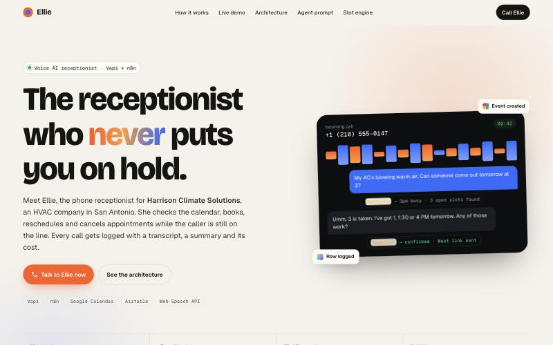
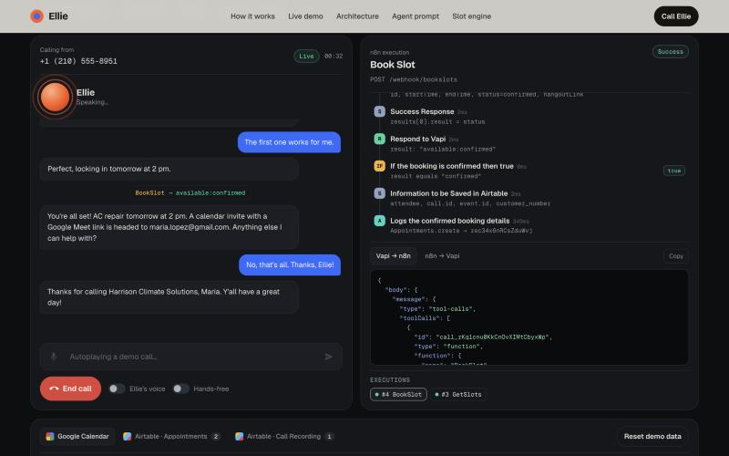

<div align="center">

# Ellie, the receptionist who never puts you on hold

A voice AI that answers the phone for an HVAC company, checks the real
calendar, and books the appointment while the caller is still talking.
This repo is a full working copy of that system you can run in a browser.

**[Try the live demo →](https://ellie-voice-receptionist.vercel.app)**



</div>

## The pitch

Most "AI receptionist" demos are a chat bubble that repeats the slogan
back at you. Ellie actually does the job. Say "my AC is blowing warm
air, can someone come tomorrow at 3," and she will:

1. Ask for your name and have you spell your email out loud
2. Check Google Calendar for that exact time slot
3. If it's taken, pull real open slots for the week and offer you two or three
4. Book the appointment, attach a Google Meet link, and log it to Airtable
5. Say it all back to you in a normal human sentence, not a form confirmation

Every one of those steps is real work happening behind the scenes, not a
canned response. You can watch it happen node by node.



## Why this exists

The original Ellie runs on [Vapi](https://vapi.ai) for the phone call and
[n8n](https://n8n.io) for the automation behind it, talking to a real
Google Calendar and a real Airtable base. That's great for an actual
business, but useless as something you can hand someone to try in thirty
seconds. No phone line, no n8n instance, no credentials.

So this repo rebuilds the whole thing to run entirely in the browser.
Same conversation flow, same five webhooks, same node names and
branching logic as the exported n8n workflow, just pointed at a fake
calendar and a fake Airtable base that live in `localStorage` instead of
the real thing.

## What you can do with it

- Talk to Ellie by typing or by voice (mic works in Chrome and Edge)
- Book, reschedule, or cancel an appointment and watch it land on a real
  calendar grid and in an Airtable-style table
- Say the secret phrase "Hot Brisket" and get transferred, just like the
  real agent would
- Click any tool call Ellie makes to see the exact n8n nodes that ran,
  in order, with the real request and response payloads
- Run one of four scripted calls (book with a conflict, reschedule,
  cancel, emergency transfer) if you'd rather watch than type

## How the pieces map to the real system

| In production | In this repo |
|---|---|
| Vapi (speech to text, LLM, text to speech) | `js/agent.js` for the conversation logic, `js/voice.js` for the Web Speech API |
| n8n, 5 webhooks and 55 nodes | `js/n8n.js`, same node names and the same if/else branches |
| Google Calendar | A simulated calendar in `js/store.js`, rendered as a real week grid |
| Airtable | The same `js/store.js` store, rendered as real tables |
| The LLM understanding what you said | `js/parser.js`, a rule-based parser for intent, dates, spelled emails, and names |

Nothing here is a mock in the "returns hardcoded JSON" sense. The slot
finder actually walks the calendar and computes free 30 minute windows.
The email parser actually turns "m a r i a dot l o p e z at gmail dot
com" into `maria.lopez@gmail.com`. If you book a conflicting time twice,
the second one actually fails.

## Running it locally

No build step and no dependencies. Open `index.html` directly, or serve
it so the mic permission and fonts behave:

```bash
python3 -m http.server 4330
```

Then visit `localhost:4330`.

## Project structure

```
index.html      Landing page and the live demo markup
styles.css       Every style, light landing page plus the dark demo console
js/time.js        America/Chicago timezone math
js/store.js        The fake calendar and Airtable base, saved to localStorage
js/n8n.js            The five n8n workflows, rebuilt node by node
js/parser.js           Turns typed or spoken text into dates, emails, names, intent
js/voice.js              Wraps the Web Speech API for talking and listening
js/agent.js                Ellie's actual conversation logic and call flows
js/app.js                   Wires it all to the UI: phone, execution trace, backend views
```

## Stack

Vapi · n8n · Google Calendar · Airtable · Web Speech API · vanilla JS

---

Built by [Daksh Tyagi](https://github.com/InnoxCodes)
